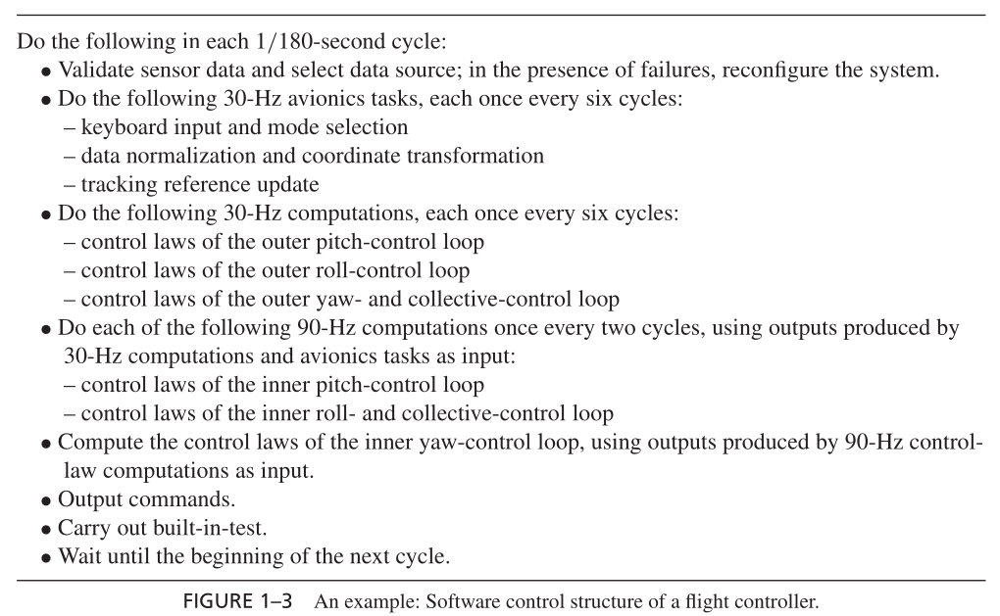

# RTOS - Lab 1: Clock-Driven Scheduling

## Objective
In this lab you implement a **multi-rate flight controller** for a helicopter, following the specification in Jane W. S. Liu's *Real-Time Systems*. You get hands-on experience with **clock-driven scheduling** by building a **structured cyclic executive** driven by a timer interrupt.



## Learning Outcomes

By the end of this lab, you will be able to:

 - Choose a frame size that satisfies the three frame-size constraints, and build a frame table.
 - Implement a structured cyclic executive in which a **timer ISR** (a `SIGALRM` handler) marks frame boundaries.
 - Share data correctly between an interrupt handler and the main program (`volatile sig_atomic_t`).
 - Wait for an interrupt without burning the CPU, and avoid the race condition this can introduce (`sigprocmask` + `sigsuspend`).
 - Explain why frames must be started by a periodic timer and not by sleeping after the work (cumulative drift).

## Requirements

A Linux machine (native, a VM, or WSL2), `gcc`, `make`, and `python3` for the checker.

## The Controller

| Job (in `provided/helicopterTasks.c`) | Rate   | Period (scaled) | WCET (scaled) |
|------------------------------|--------|-----------------|---------------|
| `dataValidation`             | 180 Hz | 50 ms           | 2 ms          |
| `keyboardDataTracking`       | 30 Hz  | 300 ms          | 4 ms          |
| `controlOuterLoops`          | 30 Hz  | 300 ms          | 9 ms          |
| `controlInnerLoops`          | 90 Hz  | 100 ms          | 6 ms          |
| `computeNComd`               | 180 Hz | 50 ms           | 3 ms          |

**Time is scaled by 9.** The real periods (1/180 s, 1/90 s, 1/30 s) are too short to observe, and too short to measure reliably on an ordinary Linux machine. Everything is therefore slowed down 9 times. The ratios between the rates are unchanged.

The periods, the WCETs, and `N_HYPERPERIODS` are defined in `provided/helicopterTasks.h` (`PERIOD_*_US`, `WCET_*_US`). Use these macros; do not hard-code numbers. Each mock job prints a timestamped line, then keeps the CPU busy for its WCET:

```
206605.528152 *** dataValidation
206605.530152 *** keyboardDataTracking
```

**The frame size and the hyperperiod are not given: you compute them.** Use the **largest frame size that satisfies the three frame-size constraints** of the lecture. A larger frame means fewer timer interrupts, and therefore less overhead.

## What You Must Implement

You build a **structured cyclic executive** in steps. Each step has its own template file in `src/`, and you fill in every one of them. The steps share the frame table, so they differ only in how `main()` waits for the next frame. Do not delete an earlier step when you move to the next one: the questions in `lab1_answers.md` compare them.

| File | Step | Content |
|---|---|---|
| `frameTable.h`, `frameTable.c` | 0 | your frame size, hyperperiod and frame table, plus the generic code that runs one frame |
| `step1_busywait.c` | 1 | timer + handler + **busy-wait** |
| `step2_pause.c` | 2 | the same, waiting with **`pause()`** |
| `step3_sigsuspend.c` | 3 | the same, without the race: **`sigprocmask` + `sigsuspend`** |

Each step builds into its own program (`step1`, `step2`, `step3`). In every step:

- **Frames are timer-driven.** A `setitimer` timer with your frame period, and a `SIGALRM` handler. The handler only records that a tick happened. `main()` waits for the tick, then runs the jobs of the current frame.
- **The executive is generic.** It walks the frame table, and does not hard-code calls per frame with `if`/`switch`.
- **The run is bounded.** Run exactly `N_HYPERPERIODS` hyperperiods, then return 0. Do not use `while(1)`.

Frame table rules (the checker enforces them):

- Every frame starts with `dataValidation` and ends with `computeNComd`.
- Inside a frame, jobs follow the data flow of the controller: `dataValidation` → `keyboardDataTracking` → `controlOuterLoops` → `controlInnerLoops` → `computeNComd`.
- Every job runs **exactly once in each of its periods**. Periods start at time 0. Within a period, you choose the frame.
- Every hyperperiod repeats the same table.

### Folder layout

| Folder | What it holds | You... |
|---|---|---|
| `src/` | the templates above | **fill in** every file; you may add `.c`/`.h` files here |
| `provided/` | `helicopterTasks.h` (periods, WCETs, `N_HYPERPERIODS`) and `helicopterTasks.c` (the mock jobs) | read, do not modify |
| `examples/` | small programs about timers, signals and `volatile` | read and run |
| `scripts/` | the checker | do not modify |
| `build/` | object files, created by `make` | ignore |

The answers go in `lab1_answers.md`, at the top of this folder. The `Makefile` links every `.c` file of `src/` whose name does not start with `step`, plus `provided/helicopterTasks.c`, into all three programs, and builds the programs `step1`, `step2`, `step3` in this folder. **Modify only `src/` and `lab1_answers.md`**: do not modify, delete, or rename any other file of this folder. `provided/`, `Makefile`, and `scripts/` are restored to their original version when your work is checked.

### Step 0 - Frame size and frame table

Answer Q1 and Q2 of `lab1_answers.md`: compute the hyperperiod, choose the largest frame size that satisfies the three constraints, and build your frame table with the load of each frame. Then write the results in `frameTable.h` and `frameTable.c`.

### Step 1 - Timer and busy-wait (`step1_busywait.c`)

Start from `examples/timerExample.c`. It sets a periodic timer, and its handler increments a counter. `main()` **busy-waits**: it tests the counter again and again until the value changes.

Turn it into your cyclic executive: use your frame size as the timer period, wait for each tick, then run the jobs of the current frame from your table.

```bash
make check1
```

At this step, the checker accepts a busy-wait. It prints `CPU load` (CPU time divided by wall time); write the value down.

Before moving on, read the next section and run the first half of Q3 (`volatile` removed in `step1_busywait.c`, then put back).

### The volatile lesson

The timer handler and `main()` communicate through a variable, for example a tick counter:

```c
static int ticks = 0;                       /* WRONG */
static void onTimer(int signo) { ticks++; }

/* in main(): wait for the next tick */
while (ticks == frame) { }
```

This looks correct, and at `-O0` it works. At `-O2`, the optimization level used by the `Makefile`, **it hangs forever**.

**Why it hangs.** The compiler optimizes `main()` as if it were the only code that ever runs. Inside `while (ticks == frame) { }` nothing writes `ticks` and nothing calls a function. The compiler therefore assumes that `ticks` cannot change during the loop. It reads `ticks` once, keeps the value in a register, and turns the wait into a jump to itself. The handler does update `ticks` in memory, but the loop never reads memory again. You can see this in the code gcc generates for `examples/volatileDemo.c`:

```
    movl  tick(%rip), %eax     ; the ONLY read of tick
    testl %eax, %eax
    jne   .L4
.L5:
    jmp   .L5                  ; infinite loop: tick is never read again
```

Try it yourself:

```bash
make volatile-demo                              # runs both versions
gcc -O2 -S examples/volatileDemo.c -o - | less  # look for "jmp" back to the same label
```

**The fix.** Declare every variable written by a signal handler and read by `main()` (or the reverse) as:

```c
static volatile sig_atomic_t ticks = 0;
```

- `volatile` tells the compiler that the value can change at any time without any visible code doing it. Every read in the source becomes a real memory read, and every write a real memory write.
- `sig_atomic_t` is an integer type that is read and written in a single access, so `main()` never sees a half-updated value when the signal arrives in the middle of a read.

**What volatile does *not* do:**

- It does not make `ticks++` atomic, and it is not a lock. This lab is safe only because **one side writes and the other side only reads**: the handler increments, `main()` only compares. If both sides wrote the same variable, updates could be lost.
- It is not a performance hint, and it does not fix a program that is wrong for other reasons.
- If your program **only works at `-O0`**, you are missing a `volatile`. Removing `-O2` from the `Makefile` hides the bug; it does not fix it.

**Two more handler rules:**

- A handler must have the prototype `void handler(int signo)`. Casting a `void f(void)` to `void (*)(int)` is undefined behaviour.
- Do not call `printf` inside a handler: it is not async-signal-safe. The handler records the tick; the work runs in `main()`.

### Step 2 - Stop burning the CPU: `pause()` (`step2_pause.c`)

Your Step 1 program spends almost all of its time testing a variable that changes only once per frame. The checker showed it: the `CPU load` is close to 100 %, while the jobs need only a fraction of that. On a real controller, this CPU time is lost to every other activity, and the energy is wasted.

Copy your `step1_busywait.c` into `step2_pause.c`, and change **only** the wait. `pause()` (from `<unistd.h>`) suspends the process until a signal is delivered. When the handler returns, `pause()` returns too. Put it in the body of your wait loop, so that the loop sleeps instead of spinning. Keep the loop and its test: `pause()` returns after *any* signal, and the condition decides whether the tick you wait for has really arrived.

```bash
make check2
```

From this step on, the check fails if the `CPU load` stays above 60 %. Compare the new value with your Step 1 value, and with the load you can predict from your frame table (Q4).

Then finish Q3: remove `volatile` in `step2_pause.c`. The program probably still works; the README section above explains why it is still wrong. Put `volatile` back afterwards.

### Step 3 - The race in `pause()` (`step3_sigsuspend.c`)

There is a small window between the moment your loop tests the counter and the moment it calls `pause()`. If the tick arrives exactly in that window, what happens? Work out the sequence of events (Q5).

Copy your `step2_pause.c` into `step3_sigsuspend.c`. The fix is to block `SIGALRM` while you test the condition, and then to unblock it and sleep in a **single atomic** operation. Look up `sigprocmask(2)` and `sigsuspend(2)`.

```bash
make check3
```

## Checking Your Work

```bash
./run.sh 1          # build and run step 1 (or 2, 3), shows the trace
make check1         # Step 1: busy-wait accepted
make check2         # Step 2: the program must sleep between frames
make check3         # Step 3: no race between the test and the sleep
make check          # all three steps
```

The checker reports either `PASS` with your frame table, or the first problem it found. It checks:

| Check | What it catches |
|---|---|
| The program exits normally within 10 s | infinite loop, crash, missing `volatile` (busy-wait that hangs at `-O2`) |
| Median frame length = the largest feasible frame size, with 90 % of frames within ±25 % | a wrong frame size (Q1), frames not timer-driven |
| The trace splits into `N_HYPERPERIODS` hyperperiods of frames that follow the frame table rules | a wrong hyperperiod, a wrong table, missing jobs |
| Total run time = number of frames × frame size, ± 1 % | **cumulative drift**: sleeping one frame *after* the jobs instead of waiting for the next tick |
| `CPU load` ≤ 60 % (steps 2 and 3) | a busy-wait between frames |

A `WARNING` does not make the check fail, but it will cost points. For example, a program can pass by luck without `volatile`.

## Using AI Assistants

You may use an AI assistant to **understand**: ask it to explain signals, `volatile`, the frame-size constraints, a compiler error, or a checker message. You may not use it to **write** your executive, your handler, your wait loop, or your answers.

Declare any AI use in Q6 of `lab1_answers.md`. Declared use is not penalized; undeclared use is.

## Submission Guidelines

- The lab can be completed **individually, in pairs, or in groups of three**.
- Submit your completed `src/` (all step files, `frameTable.h`, `frameTable.c`, and any file you added) and your completed `lab1_answers.md`:
  1. Work on a branch named `lab1`: `git checkout -b lab1`.
  2. Push it, and open a pull request from `lab1` into `main`.
  3. Each push re-runs `make check1`, `check2` and `check3`. See the results in the **Checks** tab of the pull request.

  The branch must be named exactly `lab1`, or the checks do not run. Do not modify `.github/`.

## Grading Criteria
 - **Compilation:** 3 points (`make check` builds without errors)
 - **Output correctness:** 7 points (`make check1`, `make check2` and `make check3` pass; they are run several times and must pass every time)
 - **Documentation quality:** 3 points (code comments and `lab1_answers.md`)
 - **Effective use of ISRs for timing, code modularity, and reusability:** 7 points (code review: generic executive, frame table, minimal handler, correct `volatile sig_atomic_t`, `pause()` used correctly in Step 2, no race in Step 3)

> **Important:** All submissions will undergo a **similarity check**. Any attempt to copy a colleague's work will result in a **complete reset of the grade for both parties**.
